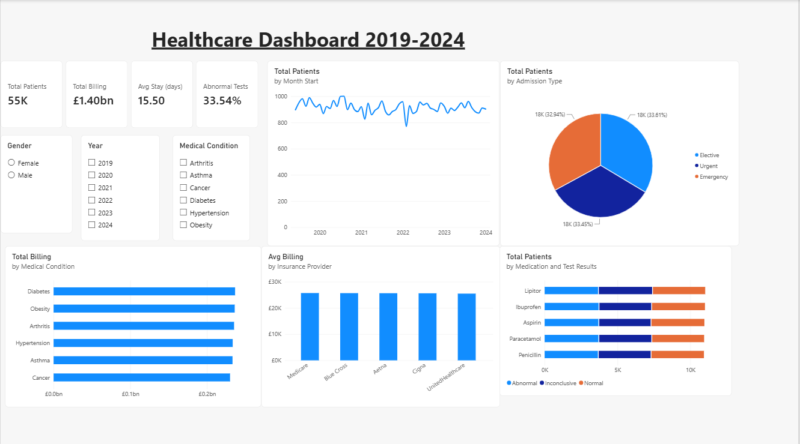

# Healthcare Analytics: Excel, SQL and Power BI

An end-to-end portfolio project. I cleaned a 55,500-row healthcare dataset in Excel, answered 11 business questions in SQL, and built an interactive Power BI dashboard.

**Tools:** Excel · SQL (SQLite) · Power BI (DAX)

## 1. Data cleaning (Excel)

| Problem | Fix |
| --- | --- |
| 534 duplicate rows | Removed |
| 106 negative billing amounts | Removed as impossible values |
| Patient names in random case | Converted to proper case |
| Corrupted hospital names | Rebuilt into readable names |
| Billing amounts with 6+ decimal places | Rounded to 2 decimal places |
| No length-of-stay field | Added: discharge date minus admission date |

Result: 54,860 clean rows.

## 2. SQL analysis

I loaded the clean data into SQLite and answered 11 business questions using GROUP BY, HAVING, INNER and LEFT JOIN, CASE and subqueries.

All 11 queries, with the result of each: [healthcare_queries.sql](healthcare_queries.sql)

Example: which medical conditions have an average bill above the overall average?

```sql
SELECT medical_conditio,
       ROUND(AVG(billing_amount), 2) AS avg_bill
FROM Patients
GROUP BY medical_conditio
HAVING AVG(billing_amount) > (SELECT AVG(billing_amount) FROM Patients)
ORDER BY avg_bill DESC;
```

(Some column names were shortened by the import, e.g. medical_conditio.)

## 3. Power BI dashboard



A one-page dashboard with a calendar table, DAX measures (COUNTROWS, SUM, AVERAGE, CALCULATE, DIVIDE), KPI cards, a monthly admissions trend, charts by condition, admission type and insurer, and slicers for gender, year and condition.

## Key findings

54,860 admissions from May 2019 to May 2024, with £1.40bn in total billing, an average stay of 15.5 days and 33.54% abnormal test results. Admissions split about a third each across Elective, Urgent and Emergency. Average bills are almost identical across all conditions and insurers (about £25,500). The drop in May 2024 is an incomplete final month, not a real fall.

## Limitations

Results are almost identical across every group, which suggests the data is synthetic (it resembles a public Kaggle healthcare dataset). The project shows the method rather than real-world conclusions.

## About me

Latifah Boke, MSc Data Analytics (University of Portsmouth). [LinkedIn](https://www.linkedin.com/in/latifah-boke-25994b29b)
